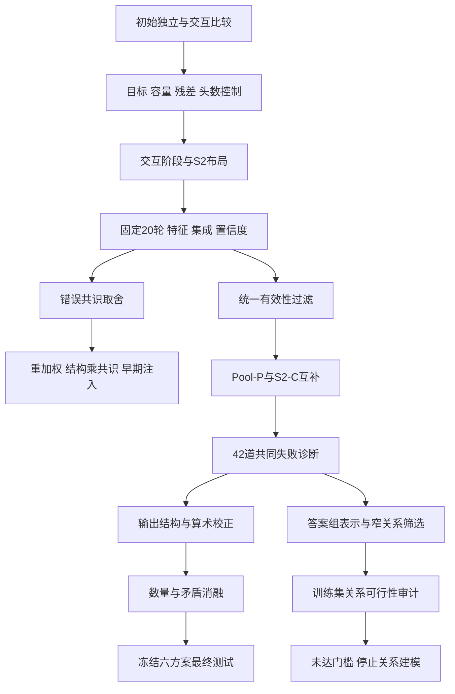

# 实验索引与更改分类台账

整理日期：2026-10-28。总诊断见 [REVIEW.md](REVIEW.md)。本表覆盖18份报告，按研究依赖与问题组织；不声称目录名日期就是精确执行顺序，也不把批量Git提交等同于单轮实验。

## 1. 统一记号

- **I**：逐候选独立MLP；**Pool**：读取其他候选的平均上下文。初始报告中的P指Pool，后期P另指解析特征，需避免混淆。
- **A/S0**：原注意力布局；**S2**：前置FFN残差、随后注意力、最后保留相应归一化的布局。S2不是第二层注意力。
- **P**：仅解析有效性；**C**：解析＋共识六维特征；普通S2表示没有这组显式特征。
- **U/K/H（重加权组）**：均匀、正确数量匹配、错误共识加权。此H与后期“历史算术方案H”无关。
- **B/N/V/NV/H（算术组）**：基础S2-C、数量、矛盾、数量＋矛盾、历史四维算术参照。
- **S2_route**：普通S2五成员、训练OOF冻结的一致率回退、最终有效性过滤；不是S2-C再加同一回退。
- **五种子均值**：五个单模型的统计；**集成**：一起推理的一个固定预测器。pp均指百分点。

## 2. 全部实验台账

分类：A结构容量，B训练目标/分配，C特征与表示，D推理规则，E集成/选择，F文本证据/诊断，G工程验证。数字默认验证集，除最终测试行外不使用测试得分。

| 编号与报告 | 类别 | 核心更改与匹配对照 | 训练/评价口径 | 代表结果与保留结论 | 报告位置建议 |
|---|---|---|---|---|---|
| E01 [初始实验](../experiments_20261017/results/REPORT.md) | A/C | 线性、独立、Pool、注意力；加近容量独立、仅自身注意力、题目TF-IDF分支 | 8配置，48次训练；两LR，验证早停，五种子 | I90.226%、Pool91.504%、A91.905%；A−I +1.679pp；题目词袋分支未改善 | 主文核心：建立交互价值 |
| E02 [训练目标](../objective_experiments_20261017/results/REPORT.md) | B | 两结构×全部BCE/混合BCE/pairwise/set-mass；混合组匹配曝光预算 | 48次训练；验证选LR与检查点 | I混合BCE91.303%，A混合BCE91.429%；原结构差距显著缩小；排序未超过相应混合BCE | 主文控制：训练分配影响结构结论 |
| E03 [容量正则](../capacity_experiments_20261017/results/REPORT.md) | A | 两结构×h128/h64/h32/dropout.3/decay.01 | 60次训练；同预算LR搜索与早停 | 原A91.905%仍最高；I h64与dropout各+0.351pp、区间跨零 | 压缩：缩小拟合差距不等于泛化提升 |
| E04 [残差修正](../residual_experiments_20261017/results/REPORT.md) | A | 独立预训练＋自修正/跨候选修正/门控/联合微调；继续训练对照 | 42次训练；两阶段，允许选第0轮 | 冻结跨候选90.326%，相对I +0.100pp、相对原A −1.579pp | 压缩负结果；保留冻结编码器与无OOF限制 |
| E05 [头数与self mask](../attention_factors_20261017/results/REPORT.md) | A | 1/2/4/8头×允许/排除自身；参数总量相同 | 48次训练；两LR、早停 | exclude_h2 92.005%；对原模型+0.100pp，区间跨零 | 附录或一句话：未确认新最佳结构 |
| E06 [交互阶段](../interaction_stage_20261017/results/REPORT.md) | A | S0～S5移动FFN残差与归一化，区分同容量与新增容量 | 30主运行＋6敏感性；全60轮，但主表选验证最佳轮 | S2 92.306%；对S0 +0.401pp，五种子同向，区间跨零 | 主文简述S2来源；不得称交互越晚越好 |
| E07 [融合、特征与置信度](../fusion_confidence_20261017/results/REPORT.md) | C/E | 普通/解析/共识/风格、五/十五成员、OOF阈值回退及校准 | 40全量＋100折内拟合；固定20轮 | S2五成员735，共识740；15成员732；共识在错误最高票题37→24；回退原始739 | 主文核心：共识取舍、计算收益 |
| E08 [困难题重加权](../reweighting_experiments_20261017/results/REPORT.md) | B | P/C×U/K/H；K控制正确候选数量和正负例权重总量 | 30次训练，固定20轮；6集成 | C-H−C-K错误共识−1.667pp；C-U和C-H集成均740；预设实用目标未达到 | 主文负结果：训练关注未转化为泛化 |
| E09 [最终有效性过滤](../validity_filter_20261017/results/REPORT.md) | D/G | 固定预测器最终排除None；回退前后统一过滤 | 0训练；19对、38次官方评价 | 普通S2 735→737；共识740→740；回退739→740；统一过滤后回退净增3题 | 主文：拆出解析收益，统一评价基线 |
| E10 [结构×共识](../interaction_consensus_20261017/results/REPORT.md) | A/C/D | I/Pool/S2×P/C，六槽位对齐，统一过滤 | 30次训练；固定20轮末检查点，无优胜者选择 | 主交互+1.053pp，区间跨零；各结构C都损失错误共识；Pool-P集成736、S2-C740 | 主文核心因子实验 |
| E11 [早期共识](../early_consensus_20261017/results/REPORT.md) | B/C/D | All/D×P/C×Early/Late；加法投影匹配；单有效组旁路 | 40次训练、380更新；末检查点 | D主效应−0.251pp、C早注入−0.238pp，区间跨零；两组P集成最高737 | 压缩负结果：不把训练范围/注入位置混为一因 |
| E12 [早期错题索引](../error_diagnosis_20261017/REPORT.md) | F/G | 全验证自动索引，首批8张分层证据卡 | 0训练、0新评分；因果标注UNREVIEWED | 三代表错误并集79、共同错38；只完成索引，没有完成逐题人工诊断 | 方法说明：与后来的两代表42题区分 |
| E13 [方法互补](../method_complementarity_20261017/results/REPORT.md) | E | Pool-P与S2-C：等权、OOF固定权重、gate8/gate4 | 新补25次Pool折内训练；小选择器训练；冻结验证 | 四组合均740，修复5/损害5；oracle756；资产增至约8.12MiB | 主文：互补上界未兑现 |
| E14 [共同失败诊断](../common_failure_diagnosis_20261017/results/REPORT.md) | F | 两代表共同错42题，95份必要候选全文；训练格式普查 | 0训练、0新模型评价；人工类别与统计标签分开 | 33题主要题意/关系/条件/目标，5题局部算术；6题官方正确候选过程有错 | 主文错误分析核心 |
| E15 [文本证据](../text_evidence_20261017/results/REPORT.md) | F/C/G | 冻结S2-C，格式3维/算术4维/合并，OOF小残差 | 0新主模型；3次线性拟合、4主评价＋4重放 | 格式740，算术/合并741；3修复2损害；数量代理贡献混杂 | 主文：提出并检验证据来源 |
| E16 [答案组表示](../answer_group_20261018/results/REPORT.md) | C/B/D | CandBCE/CandMaxCE/GroupCE×NoSize/Size；同参数头 | 30训练；2114分歧题、固定380更新；组softmax集成 | 三个NoSize集成735/733/732；组表示均值优势不稳定；窄题侧筛选覆盖0/1题 | 主文摘要：组表示与损失严格区分 |
| E17 [算术消融与关系审计](../arith_relation_audit_20261018/results/REPORT.md) | F/C/G | B/N/V/NV＋H；去除比例项混杂；四类关系先开发后冻结审计 | 3小拟合、5评价＋5重放；48开发题、106检查题 | 740/739/742/741/741；V修复2损害0；四类探针未达门槛、未训练关系模型 | 主文核心：补全代理消融与停止依据 |
| E18 [最终测试](../final_test_20261028/results/REPORT.md) | G | 六套方法和主候选V评分前冻结，全部预测先生成后评分 | 0训练；6次完整测试评价 | V374/467；比较方案S2_route383/467最高；主候选不随测试排名改写 | 主文终点：结果、分布差异、资源 |

E01～E11并非一条持续叠加的单模型版本链，很多是从相同基线分叉的控制实验。E16也不是在740分S2-C上只换一个池化操作：读出、训练范围、无效候选监督、聚合概率口径均变化，必须使用本组匹配对照。

## 3. 按依赖关系重建实验历程

这是研究依赖图，不是精确的进程运行时间线。早期自动错题索引为后续诊断提供组织方式，其三代表共同错38题不能与两代表共同错42题混为同一集合。

## 4. 将“科学更改”与“实现修订”分开记账

| 更改/修订 | 具体内容 | 分类与解释 |
|---|---|---|
| 验证早停→完整60轮→固定20轮 | 前两阶段仍选验证最佳；固定20轮只取末轮 | **实验协议改变**，不是bug修复；不同协议须重建匹配基线 |
| 特征列零初始化、P槽位置零、共享初始化 | 控制P/C或特征配对起点 | **公平性控制**，不能算新信息带来的独立增益 |
| OOF分折、权重/阈值只用训练 | 分离基础模型拟合与选择规则建立 | **训练协议改进**；选择器仍需区分拟合内与独立评估 |
| 最终解析None过滤 | 使用不变官方解析器约束输出 | **推理方法改变**，已有独立配对评价，不是修改评分器 |
| 单有效答案组旁路 | 只有一个有效数值时直接选有效候选 | **规则与计算分配改变**；依赖至少一个正确候选保证 |
| 文本提取v0/v1→最终版 | 训练审计中修正百分比教学写法、外置单位、Markdown结尾等误报；保留两次旧快照 | **训练期实现修复**，冻结后未根据验证修补；没有各版本匹配验证分数，不能声称每次修复提高多少准确率 |
| 算术H→N/V/NV | 不同特征子集分别重新拟合；主消融移除错误比例项 | **新的机制消融**，不是将旧系数删几项或修复算术程序 |
| 关系提取v0→冻结探针 | 开发阶段修正嵌入what问句截取，加入阶段倍数/带单位诊断运算 | **训练集开发修订**；冻结检查发现的问题保留，不修补后在同批题上重称通过 |
| posthoc解释脚本 | 冻结后拆解分数贡献、投票分组、修复损害 | **事后分析**，没有生成新模型成绩，不与事前主比较混写 |
| portable资产、重放、来源哈希 | 将可部署资产与训练/OOF/分析记录分开 | **复现工程**；不能当作新的科学实验或独立统计重复 |
| early_consensus核验补充 | 原8574文件中仅`code/.git/FETCH_HEAD`改变；严格passed=false，实验检查通过 | **核验差异披露**；不能写成所有轮次全文件哈希都通过，也不能据此断言模型结果失效 |
| final_test冻结清单 | 明确主候选V、六方案、所有预测先于任何评分 | **最终评价协议**；不同于“看测试最高后再选择主模型” |

文本修订依据：[训练审计与版本说明](../text_evidence_20261017/results/REPORT.md)、[提取器检查](../text_evidence_20261017/check_extractor.py)、[关系审计](../arith_relation_audit_20261018/results/REPORT.md)。没有逐次代码提交证据的地方，只保留报告能支持的版本粒度，不补造修订时间或收益。

## 5. 实际Git提交历史与未提交材料

实际仓库根是`code/`，外层目录不是Git仓库。下表按现有历史记录整理，所有时间为+08:00；提交粒度与实验粒度不同。

| 提交 | 时间 | 原提交说明 | 关联材料/含义 |
|---|---|---|---|
| `0d02ba7` | 2026-10-16 18:34:31 | main | 原始代码、数据、接口、评测文件 |
| `38b8c8d`、`4be1524` | 2026-10-17 00:59:21 | 第一轮实验 | 合并历史中存在两条同题提交；第一父链所见初始、目标、容量、残差、头数报告集中于38b8c8d。不能当成两次独立重复实验 |
| `cfbc3cc` | 2026-10-17 13:40:25 | Merge branch 'master' of https://github.com/wasd-3215/code | 合并事件；本身不是新研究变量 |
| `42409e0` | 2026-10-17 15:14:21 | 交互阶段实验和模型一致性实验 | 交互阶段、融合/特征/置信度报告 |
| `2c9e482` | 2026-10-17 20:41:03 | 失败的重加权实验 | 困难题重加权 |
| `bc95978` | 2026-10-17 22:36:37 | 无用的尝试与错题分析 | 有效性过滤、结构×共识、早期共识、早期错题索引 |

最后一条提交说明是历史原文，不是本次研究评价；这些负结果和对照有机制分析价值。

本次整理开始时，下列六个目录在Git状态中为未跟踪：

- `answer_group_20261018/`
- `arith_relation_audit_20261018/`
- `common_failure_diagnosis_20261017/`
- `final_test_20261028/`
- `method_complementarity_20261017/`
- `text_evidence_20261017/`

因此，仅给出`bc95978`不足以复现最新V方案及最终测试。本次不代做提交；最终发布应记录包含必要推理源码/资产与报告的实际版本，或提供确切文件哈希的发布包。本整理目录亦为新增材料，不改变旧提交。

## 6. 哪些旧“下一步”已经完成

| 旧阶段的建议/待办 | 后续状态 | 今天应如何表述 |
|---|---|---|
| 检验显式共识是否替代交互 | E10结构×共识已完成 | 主交互不确定；错误共识取舍明显 |
| 更早注入共识/集中困难训练 | E11已完成 | 当前固定预算下未获得可靠正收益 |
| 将专家互补转为可部署收益 | E13已完成 | 现有平均/门控均未产生净增 |
| 阅读共同错误的具体原因 | E14已完成42题必要全文诊断 | 不能再把E12的UNREVIEWED状态当当前全部诊断状态 |
| 试输出格式和算术证据 | E15已完成 | 净增1题且含数量代理混杂 |
| 分离等式数量与真实矛盾 | E17已完成 | N739、V742、NV741；证据有限但来源更清晰 |
| 答案组建模 | E16已完成 | 匹配对照没有确认组表示收益 |
| 检查题目侧关系证据是否可用 | E16窄筛选及E17四族审计已完成 | 没有达到进入关系建模门槛；不是尚未做审计 |
| 冻结后测试 | E18于10月28日完成 | 仅六套最终方案；主候选V，不再称测试未触碰 |
| 课程最终报告、公开版本、作业提交 | 现有证据只确认本地实验/测试材料 | 本总览是写作和交付整理底稿，不宣称已经发布或提交 |

## 7. 证据与复现入口

各组主报告、README、protocol、官方score、冻结清单、verification共同组成证据链，不能只保留排行榜式的汇总数。

最终六方案的确切预测和评分命令、方法路径与checkpoint见 [frozen_before_test.json](../final_test_20261028/frozen_before_test.json)。V使用`arith_relation_audit_20261018/portable/inference/method.py`与`portable/pipelines/V`。共享portable目录含其它方案配置，不应未经资产清点就把整个研究目录作为单模型资产。

本整理的 [sources.json](sources.json)固定18份原报告哈希；[protected_before.json](protected_before.json)记录整理前既有文件快照；[verification.json](verification.json)记录整理后的内容复核与六份既有官方测试JSON核对。后者不代表重新进行官方评分，也不覆盖本次整理开始前所有历史操作的完整性。
