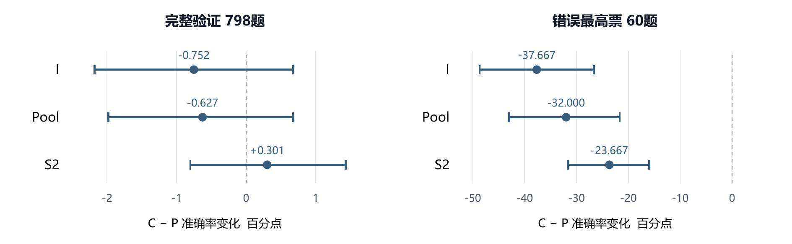

# 固定候选数学解答的可靠选择

## 候选交互 答案共识与局部算术证据

DASE7506 Advanced Machine Learning Methods · MP2 · 2026年10月28日

### 摘要

本实验研究如何在每道数学题的四个固定候选解答中选择最终数值正确的一项，重点回答候选比较的收益来自哪些信息，以及错误共识出现时如何保留少数正确答案。基于给定的1024维候选表示，我比较了独立打分、平均上下文和注意力，并通过训练目标、容量和交互位置对照检验收益来源。初始五种子平均准确率分别为90.226%、91.504%和91.905%，支持跨候选信息的价值，但注意力相对简单平均上下文的优势尚不确定。显式共识使同轮五成员集成从735/798提高到740/798，却将错误最高票题的正确数从37/60降至24/60。重加权、提前注入共识、答案组表示和专家门控均未稳定解除这一取舍。局部算术矛盾校正达到742/798，较基础模型修复2题且未新增错误，但增益很小；四类题目关系探针均未通过预设可行性门槛。冻结后，预先选定的矛盾校正方案V在测试集上为374/467（80.086%）；六套冻结比较方案中，固定回退方案观察最高，为383/467（82.013%）。由于测试仅包含多答案题，报告同时呈现完整验证、多答案验证和最终测试，避免将筛选分布差异误解为全部泛化损失。

### 1 任务与研究问题

每题输入为题干、四段候选文本及固定表示，输出一个0至3的候选索引。官方评测只检查该候选解析后的最终数值是否与参考相符；同题可以有多个正确候选，且题库保证至少一个正确候选。预测过程不得访问参考答案，也不得生成新的解答。[1]

核心研究问题是：**候选比较的收益来自哪些信息，当多个候选一致地犯错时，什么证据能帮助模型选择少数正确答案？** 我首先检验联合判断是否优于独立判断，再区分共识先验与内容证据，最后检查额外计算是否带来可部署的净收益。

表1 数据构成与评估分母

| 划分 | 题数 | 单有效答案组 | 多有效答案组 |
|---|---:|---:|---:|
| 训练 | 4755 | 2641 | 2114 |
| 验证 | 798 | 443 | 355 |
| 测试 | 467 | 0 | 467 |

单有效答案组允许包含解析失败候选；在至少一个候选正确的保证下，任取有效候选即可得分。它不同于“四候选全对”，后者在训练/验证中分别为2242/379题。有对有错的“混合题”为2513/419题，也不同于2114/355道多答案题。验证另含117道唯一正确候选题，其中60道为唯一最高票答案错误；这些子组不能相加。

<!-- PAGE -->

## 2 方法与可见信息

### 2.1 从独立打分到候选交互

令同题第i个候选的固定表示为x_i，标签y_i由官方解析与最终数值评分规则构造。各模型共享候选处理参数，不加入候选位置编码；表示的逐维标准化仅在训练输入上拟合。基础模型以四个分数的最大值选择候选，多正确标签保留为多标签监督。

表2 基础架构及其信息通路

| 模型 | 结构概要 | 跨候选信息 |
|---|---|---|
| 线性 | 1024→1 | 无 |
| I 独立MLP | 1024→128→64→1，GELU | 无 |
| Pool 平均上下文 | 1024→128，自身与四候选均值拼接，256→64→1 | 平均表示 |
| A 原注意力 | 128维、四头自注意力、残差与LayerNorm、256维FFN、评分头 | 学习候选间读取 |
| S2 布局变体 | 前置FFN残差，随后注意力，保留FFN对应归一化在后 | 与A相同输入，改变加工顺序 |

I-large是与A近似同参数量的逐候选网络；A-self限制注意力只读取自身，用于控制新增容量与计算路径。A-self的单键softmax使Q/K匹配退化，因而不是有效容量完全相等的控制。题目分支使用训练词表的TF-IDF，属于浅层词袋条件化，未调用外部预训练模型。[2,4]

### 2.2 显式答案特征与最终约束

后期记P为仅解析有效性，C为六维解析与共识特征：解析是否有效、当前答案支持数、不同有效答案数、是否处于最大答案组、最高票是否并列、前两大答案组票差。计数按四候选缩放，训练统计用于标准化。另用长度、行数、运算符、数学/答案标记及固定自信词计数检验风格代理。[5]

统一有效性过滤在原最终选择为None且存在有效候选时，改选原聚合分数最高的有效候选；原本有效的选择保持不变。按官方评分，None选择必错，因此该规则逐题不降分，但不保证替换后一定正确。后期部分实验在只有一个有效答案组时直接旁路神经模型。[6]

### 2.3 集成与局部证据校正

普通五成员集成对种子17、29、43、71、101的sigmoid分数等权平均，得到p̄_i。固定回退在五成员答案一致率不高于0.8、且生成候选存在至少三票的唯一最高票答案时使用该答案；阈值来自训练集折外预测（OOF），最终仍过滤无效选择。

文本校正冻结S2-C，使用分数 s_i = logit(p̄_i) + βᵀf_i。基础系数固定为1，无截距，采用未缩放特征，以训练OOF上的候选BCE之和加0.5‖β‖²拟合β，L2固定为1，不搜索阈值或惩罚系数。仅矛盾方案V使用log(1+矛盾等式数)和最后可检查等式是否矛盾两项。候选偏移完全相同时保持原排序。未知表达式不判错，过程矛盾只作软证据。[12,13]

<!-- PAGE -->

## 3 实验协议与统计口径

### 3.1 开发阶段与公平比较

全部参数仅用训练数据及训练参考拟合，验证集用于开发、诊断与方法选择。基础训练采用AdamW、batch 256、dropout 0.1、weight decay 0.001、梯度裁剪1；除明确的消融外保持不变。正式完整准确率由未修改的独立官方评分器产生。协议经历三个阶段，不能把不同阶段最高分串成逐步增益。[2–8]

表3 三类训练协议

| 阶段 | 学习率与预算 | 检查点选择 | 比较边界 |
|---|---|---|---|
| 初始结构、目标、容量、残差、头数 | seed17搜索0.001/0.0003，最多60轮，patience10 | 验证正确数，再以损失和较早轮次决胜 | 同搜索预算；实际更新数可不同 |
| 交互阶段 | 主LR0.0003，完整60轮；另有seed17敏感性运行 | 每种子验证最佳轮；另报10/20/40/60轮 | 跑满60轮不等于固定末轮评价 |
| 特征、共识及后期受控实验 | 通常固定20轮、LR0.0003 | 固定末轮，无早停 | 新实验内部匹配；不可套用历史最佳轮 |

融合实验另重置dropout随机状态以匹配特征配对，历史S2第20轮也不能直接作为其基线。目标实验对混合题循环取样，使预算轮次仍有4755次抽样；早期共识和答案组实验使用2114道输入定义的分歧题，同样固定380次更新。因此“删掉容易题”同时改变重复曝光与正负比例，不能仅归因为去掉无用梯度。

### 3.2 指标与不确定性

主要指标是完整题库选择准确率，同时报告多答案、唯一正确候选和错误最高票子组，以及配对的修复数、损害数和净增。五种子均值表示单模型训练波动；五成员集成是另一个固定预测器；已知标签后任选正确方法的oracle仅为诊断上界。

配对区间按题目重采样，单模型比较先对同题五种子的正确性取平均，不将5×798个观测视为独立样本。初始实验采用5000次bootstrap，主要后续比较为10000次。区间条件于已拟合模型，不包含全部调参和历史选择不确定性，也未校正多重比较。反复使用同一验证集的结果属于开发证据。

### 3.3 OOF与冻结最终测试

OOF按整题五折划分，四候选不跨折，各折标准化仅拟合其余四折。基础模型不在留出折上挑检查点。OOF可用于拟合阈值和校正器，但校正器在全部OOF上拟合后的成绩仍是拟合内诊断，不是校正器自身的无偏交叉验证。[5,10,12]

最终测试于10月28日执行。V及另外五套比较方案的代码、权重、配置、顺序和主候选身份均在评分前冻结；六份预测全部生成并保存哈希后，才逐一评分。没有根据测试结果重新训练、搜索、融合或更改主候选。[14]

<!-- PAGE -->

## 4 候选交互的收益与结构控制

### 4.1 跨候选信息优于初始独立判断

表4 初始实验的五种子结果与控制模型 [2]

| 模型 | 参数量 | 验证均值 ± SD % | 相对I差值 pp |
|---|---:|---:|---:|
| 线性 | 1025 | 90.075 ± 0.241 | −0.151 |
| I 独立MLP | 139521 | 90.226 ± 0.266 | 0 |
| Pool 平均上下文 | 147713 | 91.504 ± 0.348 | +1.278 |
| A 候选注意力 | 272001 | 91.905 ± 0.514 | +1.679 |
| I-large 容量对照 | 271489 | 90.476 ± 0.396 | +0.250 |
| A-self 仅自身 | 272001 | 90.075 ± 0.429 | −0.151 |
| I-Q 题目词袋 | 192929 | 90.201 ± 0.272 | −0.025 |
| A-Q 题目词袋 | 325409 | 91.353 ± 0.153 | +1.127 |

表内差值由显示均值相减，主要统计比较以原始配对结果为准。固定首候选为78.195%，多数投票为86.216%；多数投票额外读取答案文本，不能当作纯表示模型的同信息基线。

A−I为+1.679pp，95%描述区间[+0.677,+2.732]；Pool−I为+1.278pp，[+0.326,+2.306]。A也优于近容量独立模型与仅自身注意力，支持跨候选读取的作用。A−Pool仅+0.401pp，区间[−0.351,+1.178]，尚不足以证明注意力稳定优于简单平均上下文。题目词袋未提高分数，只能否定当前浅层分支的收益，不能否定题干信息本身。

### 4.2 训练分配改变了结构优势

表5 训练目标与结构的联合比较 五种子均值 % [3]

| 训练目标 | I | A | A−I pp |
|---|---:|---:|---:|
| 全部题BCE | 90.226 | 91.905 | +1.679 |
| 混合题BCE | 91.303 | 91.429 | +0.125 |
| 成对排序 | 91.028 | 91.203 | +0.175 |
| 正确集合概率质量 | 90.827 | 90.652 | −0.175 |

混合题BCE使I提高1.078pp，区间[+0.150,+2.055]，而A未同步提高。排序和集合目标也未超过相应混合BCE。这说明初始结构差距依赖训练分配；推理时读取其他候选与仅在训练损失中比较正负候选是两种不同机制。

### 4.3 结构微调的增量不确定

缩小I至64维提高0.351pp但区间跨零；注意力缩小或增加dropout未改善均值。冻结独立编码器后增加跨候选残差仅得90.326%，比原A低1.579pp，且该两阶段实验未使用OOF来源。排除自身的两头注意力达到92.005%，只比原模型高0.100pp。S2布局达到92.306%，对同轮S0提高0.401pp、五种子同向，但区间仍跨零。整块前置没有相同收益，因此不能概括为“交互越晚越好”。这些控制支持保留交互，却未提供可靠的第二次结构突破。[3,4]

<!-- PAGE -->

## 5 共识收益与错误多数的代价

### 5.1 共识不是跨候选比较的充分替代

我使用I、Pool、S2三种结构与P/C两种输入组成固定20轮实验。每个结构的P/C共有权重、特征槽位及初始函数匹配，统一最终解析过滤。主要比较为Δ=[Acc(S2-C)−Acc(I-C)]−[Acc(S2-P)−Acc(I-P)]。[7]

表6 结构与共识的六组受控结果

| 配置 | 全验证均值 ± SD % | 错误最高票均值 % | 五成员正确/798 |
|---|---:|---:|---:|
| I-P | 91.003 ± 0.556 | 50.000 | 731 |
| I-C | 90.251 ± 0.324 | 12.333 | 718 |
| Pool-P | 92.256 ± 0.163 | 60.333 | 736 |
| Pool-C | 91.629 ± 0.359 | 28.333 | 731 |
| S2-P | 91.855 ± 0.524 | 60.000 | 735 |
| S2-C | 92.155 ± 0.392 | 36.333 | 740 |

Δ为+1.053pp，95%描述区间[−0.150,+2.281]。它的正点估计部分来自I加入共识后下降，不能仅凭差值之差断言共识提升了所有结构。I-C通过显式特征访问答案组信息，也不再是完全独立的信息条件。



图1 C−P的五种子平均准确率变化及95%题目配对描述区间。左右图横轴尺度不同；整体为798题，错误最高票为60题。各结构的共识输入都降低了错误最高票子组准确率，区间未校正多重比较。

### 5.2 提高总体分数没有消除可靠性取舍

更早的融合实验中，普通S2五成员735/798，共识五成员740/798；错误最高票题却由37/60降至24/60，唯一正确候选题由75/117降至63/117。后者两子组重叠，不能累计损失。共识使模型更依赖重复答案，当重复来自共同错误时便压制少数正确选择。[5]

风格对照也不支持把收益归给“更像好解答”的表面形式：在解析特征之上加入风格的均值变化为−0.075pp，在共识之上加入风格仅+0.025pp，区间均跨零。当前证据更支持共识与结构共同改变选择偏好，而非模型已验证了完整推理。

<!-- PAGE -->

## 6 修复错误共识的尝试及计算收益

### 6.1 训练分配与表示重组

表7 主要修复尝试及其匹配比较 [8–10]

| 尝试 | 主要比较或结果 | 解释 |
|---|---|---|
| 困难题重加权 | C-H对C-K在错误共识上−1.667pp，区间[−4.333,+0.667] | 未确认特别关注错误共识优于正确数量匹配权重 |
| 仅训练分歧题 | All/D主效应−0.251pp，区间[−0.821,+0.332] | 等更新预算下增加困难题重复曝光未显示可靠收益 |
| 共识提前注入 | C条件Early−Late为−0.238pp，区间[−0.877,+0.376] | 更早读取共识未解除当前取舍 |
| 答案组表示 | GroupCE对匹配CandMaxCE均值+0.301pp，区间[−0.376,+0.977] | 种子方向不稳定；集成732对733，少对1题 |

重加权用K控制正确候选数量和总正负权重，只将单正确题内部的权重重新分配给错误共识题。C的错误共识训练准确率从83.106%升至88.937%，验证仅提高0.333pp；训练拟合提升没有转化成相应泛化。早期注入使用匹配的加法投影，与历史拼接头不是同一读出，因此应以内部分组比较为准。

答案组实验以CandBCE、CandMaxCE和GroupCE区分监督目标与表示池化，并单独控制显式支持数。NoSize三组集成为735、733、732。CandMaxCE将错误最高票题从31/60提高到35/60，但总体减少2题；GroupCE为34/60，没有超过纯损失对照。NoSize只移除了显式大小特征，组成员关系和池化仍可能携带数量信息，不能称为彻底去掉票数先验。

### 6.2 互补上界没有转化为净收益

冻结Pool-P与S2-C在38道验证题上输出不同数值。Pool独有正确16题，S2-C独有正确20题，二者任一正确的oracle为756/798。等权平均、训练OOF选定权重、8特征门控和4特征门控都得到740/798，相对S2-C均修复5题、损害5题。四种方法同分并非同一份预测；简单分差、一致率和票数没有可靠决定何时切换专家。[10]

### 6.3 更多计算何时值得

在融合实验中，普通S2由固定seed17的724题提高到五成员735题；十五成员平均仅732题，资产从5.242增至13.347 MiB。固定seed17的比较受该种子本身表现影响，不等于五次独立集成重复。两专家门控约需8.12 MiB，对比S2-C的5.25 MiB，却没有总体净增。[5,10]

最终过滤将普通S2从735提高到737，计算开销很小；在统一过滤基础上加入冻结回退得740，修复5、损害2，净增3。原735到740的5题不能全部归于置信度判断。部分零阈值回退仅替换无法解析的原选候选，属于解析修正。答案级分差的置信度诊断也不能自动保证低置信时投票更正确。[5,6]

这些负结果使后续研究转向新的可核实文本证据。它们不证明所有重加权、答案组模型或门控都无效，而是说明当前预算下重组既有分数与向量尚未稳定解决主要错误。

<!-- PAGE -->

## 7 共同失败与局部算术证据

### 7.1 主要失败发生在题意到计算的对应关系

对Pool-P与S2-C共同失败的42题，审阅题干、所选错误候选及所有官方数值正确候选，共95份必要候选全文。每题给一个主类别，次要问题另存。该分类由AI辅助完成，没有独立第二位评审，也不代表全部题库的错误分布。[11]

表8 共同失败题的主类别

| 主类别 | 题数 | 主类别 | 题数 |
|---|---:|---|---:|
| 数量 实体或累计范围 | 13 | 局部算术等式 | 5 |
| 题意到数量关系绑定 | 8 | 单位换算 | 1 |
| 遗漏 改写或添加条件 | 8 | 输出与解析口径不匹配 | 2 |
| 中间量未回答所求量 | 4 | 题面与参考计算疑点 | 1 |

前四类合计33题。42题中40题两代表选中相同错误数值，38题仅一个候选正确；高一致性可能反映共同偏差。另有6题的唯一官方正确候选存在显著过程错误，却碰巧落到正确数值，因此不能发现过程错误便硬淘汰。

### 7.2 将算术矛盾与数量代理拆开

第一轮冻结S2-C后分别加入格式、算术、合并证据，结果为740、741、741。算术校正的5次正确性变化中，4次排序翻转只来自可检查等式数量差异，产生2修复和2损害。于是后续冻结同一提取器，比较B无证据、N仅数量、V仅矛盾、NV合并，并以历史四维H作回放。主消融移除错误比例项，避免其分母重新引入数量。[12,13]

表9 算术证据的受控消融

| 方案 | 正确/798 | 修复/损害 | 净增 | 对B差值的95%描述区间 pp |
|---|---:|---:|---:|---|
| B 基础模型 | 740 | 0/0 | 0 | [0, 0] |
| N 数量 | 739 | 2/3 | −1 | [−0.627, +0.376] |
| V 矛盾 | 742 | 2/0 | +2 | [0, +0.627] |
| NV 数量与矛盾 | 741 | 3/2 | +1 | [−0.376, +0.627] |
| H 历史四维校正 | 741 | 3/2 | +1 | [−0.376, +0.627] |

V纠正了将9+12+8+8+3写成32、以及将15×58940写成883100的候选选择，但前一题新选候选自身仍有计数解释瑕疵。另一题由6420改选6411.44仍错：局部计算更一致，却按复利而非原本金计息。算术一致性不能代替题意验证。

V仅有两道得分分歧，精确双侧配对符号检验p=.5，bootstrap区间接触0，不能称稳定泛化提升。格式校正未改变最终数值选择；这既受信号稀少影响，也受基础模型分差影响，不能由零净增推断格式线索不存在。纯数值提取在共同错42题中仅7题发现任一候选矛盾，覆盖不足以处理主体语义问题。

<!-- PAGE -->

## 8 关系证据审计与冻结测试

### 8.1 关系抽取未达到建模门槛

训练集按整题固定划分为2853道开发题和1902道检查题，开发阅读48题。冻结后审阅106道去重检查题及107条提取判断，先隐藏参考和模型分数，冻结语义审阅，再关联训练数值标签。四族范围分别为显式数字费率、相邻性别计数、序号时段倍数以及所求类别与末步运算形状。[13]

表10 冻结关系审计 各族预定命中样本

| 关系族 | 抽样题 | 判断条数 | 可确认语义对应 | 支持题 | 可区分题 |
|---|---:|---:|---:|---:|---:|
| 总量 每份量及单位 | 25 | 12 | 9/12 | 2 | 0 |
| 实体与数量 | 16 | 24 | 24/24 | 5 | 1 |
| 条件使用 | 25 | 0 | 无判断 | 0 | 0 |
| 所求量与末步 | 25 | 48 | 23/48 | 11 | 2 |

预设门槛要求至少20道确认支持的多答案题、40条判断来自至少20题、语义支持率至少95%、10道可区分候选题，并有正确/错误对照。四族均未达到，因此没有训练关系选择模型。另20道负对照贡献23条判断，总审阅107条；各族表内比例不代表总体精度。售价、成本、利润可有同单位却不同语义角色，复述人数不代表用对人数，最后作减法也未必在求差额。失败指向当前绑定与覆盖不足，不否定所有关系方法。

### 8.2 最终测试与筛选差异

表11 六套评分前冻结方案 保留预定名单顺序 [14]

| 方案 | 完整验证/798 | 多答案验证/355 | 测试/467 | 测试准确率 % |
|---|---:|---:|---:|---:|
| V 仅矛盾 主候选 | 742 | 299 | 374 | 80.086 |
| H 历史算术 | 741 | 298 | 377 | 80.728 |
| NV 数量与矛盾 | 741 | 298 | 377 | 80.728 |
| B S2-C五成员 | 740 | 297 | 368 | 78.801 |
| S2_route 固定回退 | 740 | 297 | 383 | 82.013 |
| Pool-P五成员 | 736 | 293 | 375 | 80.300 |

主候选V由验证集选定，其正式测试为80.086%。S2_route是六套比较方案的测试观察最高值，不能据此改写测试前选择依据。V较B测试多对6题，H/NV多对9题，但未据此开展新的逐题开发或声称稳定优越性。

六方案均答对443道单有效答案组验证题。S2_route的完整验证92.73%到测试82.01%下降10.72pp，而同筛选口径的多答案验证83.66%到测试只下降1.65pp；V对应84.23%到80.09%，下降4.14pp。容易题比例解释分数尺度，却不改变六方案的验证排名，因而不能单独解释排名翻转。剩余差异可能来自抽样、困难题内部构成和重复验证开发，现有证据不能分离其贡献。

<!-- PAGE -->

## 9 计算成本与复现

### 9.1 部署资源

本机为AMD Ryzen 7 4800U，Python 3.12.14、NumPy 2.5.3、PyTorch 2.7.1+cpu。训练与推理均使用CPU，数值工作串行，Torch intra-op为4、inter-op为1，OpenBLAS为1。以下时间为完整467题的新预测进程加独立评分进程墙钟时间，含启动、导入、输入/资产加载、文本处理与全部集成成员。[14]

表12 最终方案资源记录

| 方案 | 新进程预测加评分 秒 | 展开后推理资产 MiB |
|---|---:|---:|
| V | 7.642 | 5.24880 |
| H | 9.513 | 5.24892 |
| NV | 8.788 | 5.24887 |
| B | 5.289 | 5.24866 |
| S2_route | 5.442 | 5.24164 |
| Pool-P | 5.353 | 2.87068 |

每套资产包含权重、预处理统计和配置，按NPZ展开内容计数，均低于16 MiB；不能将全部研究目录或多套互斥方案合并后仍引用单套大小。本机测时不等于官方Xeon Platinum 8457C四线程30秒认证，单次时间也不构成精确的速度排名。

### 9.2 训练与搜索投入

按各组实际训练次数累加，共577次神经网络拟合，包括重复基线、学习率搜索与折内拟合，不是577个独立结构。初始/目标/容量/残差/头数/交互阶段分别为48/48/60/42/48/36次；融合140次（40全量、100折内），重加权30次，结构×共识30次，早期共识40次，互补新增25次，答案组30次。文本与算术消融另各3次小残差拟合，阈值、权重和门控搜索另计。[2–10,12,13]

代表性耗时为初始48次517.4秒、交互阶段36次1716.4秒（含固定轮次评分）、融合140次17.87分钟；后期算术三次拟合及准备1.62秒。各组计时包含诊断的范围不同，因此不把这些数字直接求和为纯训练时间。完整搜索成本和逐次记录保留在各组报告及cost文件。

### 9.3 冻结方案重放

在code目录安装固定依赖，并按上述线程设置运行。下面命令使用新的输出目录；完整环境命令与源文件哈希见随附REPRODUCIBILITY.md和source_manifest.json。

```powershell
$v='arith_relation_audit_20261018/portable'
python -B predict.py --method "$v/inference/method.py" `
  --checkpoint "$v/pipelines/V" --split test `
  --output report_replay_001/test-predictions.json
python -B score_predictions.py --split test `
  --predictions report_replay_001/test-predictions.json `
  --output report_replay_001/test-score.json
```

官方预期为374/467，accuracy=80.08565310492506。预测只使用当前bank、arrays与冻结资产；参考仅由评分器读取。人工关系标注的复现是回放固定审阅输入，不是自动完成新的独立审阅。代码版本以冻结文件哈希识别，不能仅用尚未包含全部后续目录的历史Git提交代替。[13,14]

<!-- PAGE -->

## 10 讨论与结论

实验支持跨候选信息的价值，但未充分确认复杂注意力稳定优于平均上下文。共识使整体分数与抗错误多数能力出现取舍，训练重加权、早期条件化、答案组池化与专家选择在本次预算内主要重新分配错误。局部算术矛盾提供了可解释的小幅增量；可靠的题目条件、实体、单位角色与计算步骤绑定仍未建立。

这些结论受三方面限制。首先，验证集被反复用于结构、协议与特征开发，五种子和配对区间不能消除选择偏差。其次，最终测试只覆盖六套冻结方案，没有独立确认早期全部结构对照；测试与完整训练/验证还存在明确筛选差异。最后，42题诊断与关系审计没有第二位独立评审，过程错误分类不能等同于模型内部机制，也不能证明固定表示已经丢失必要信息。

因此，本实验将主结论限定为当前固定表示、候选生成方式和资源约束下的选择行为。进一步研究应先提高关系证据的忠实性与有效覆盖，再在新的开发/检查安排中评价其增量；不能根据已见测试错因继续修改规则后仍称为独立测试。

### AI辅助与复用披露

实验设计、代码实现、运行编排、结果分析、文本证据审阅及本报告写作使用了Codex AI辅助。语义案例审阅由Codex完成，未声称独立人工复核。模型使用给定训练数据从随机初始化训练，后期复用项目内冻结权重与OOF；没有引入外部训练数据、额外预训练权重或推理API。题目来自GSM8K，候选与固定表示由课程提供的Qwen3-0.6B生成，归属与许可见数据NOTICE及manifest。[1]

### 参考与实验记录

以下编号对应本地实验包中的一手记录，目录均相对code；除[1]与特别注明外，结果文件为所列目录的results/REPORT.md。详细版本由随附source_manifest.json标识。

[1] 课程任务与数据协议：../guide/GUIDE.md；data/manifest.json；data/NOTICE.txt。

[2] 初始结构与题目分支：experiments_20261017。

[3] 训练目标及容量控制：objective_experiments_20261017；capacity_experiments_20261017。

[4] 残差 头数与交互阶段：residual_experiments_20261017；attention_factors_20261017；interaction_stage_20261017。

[5] 集成 特征与置信度：fusion_confidence_20261017。

[6] 最终有效性约束：validity_filter_20261017。

[7] 结构与共识因子实验：interaction_consensus_20261017。

[8] 重加权与早期共识：reweighting_experiments_20261017；early_consensus_20261017。

[9] 答案组表示：answer_group_20261018。

[10] 方法互补与门控：method_complementarity_20261017。

[11] 错误诊断：common_failure_diagnosis_20261017；error_diagnosis_20261017/REPORT.md。

[12] 输出格式与算术证据：text_evidence_20261017。

[13] 算术代理消融与关系审计：arith_relation_audit_20261018。

[14] 冻结最终评价：final_test_20261028/results/REPORT.md及frozen_before_test.json。
